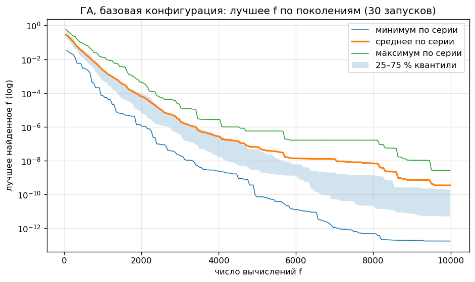
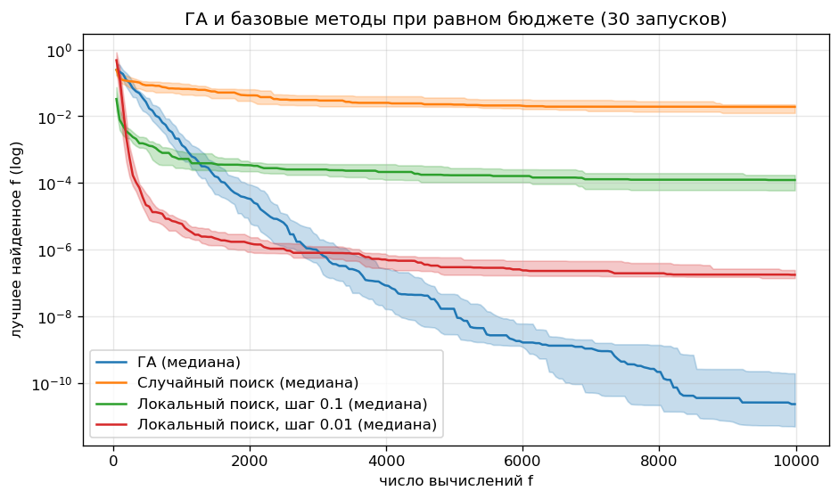
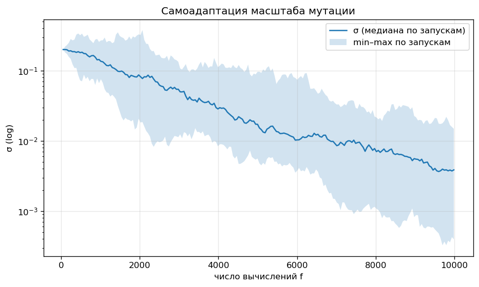
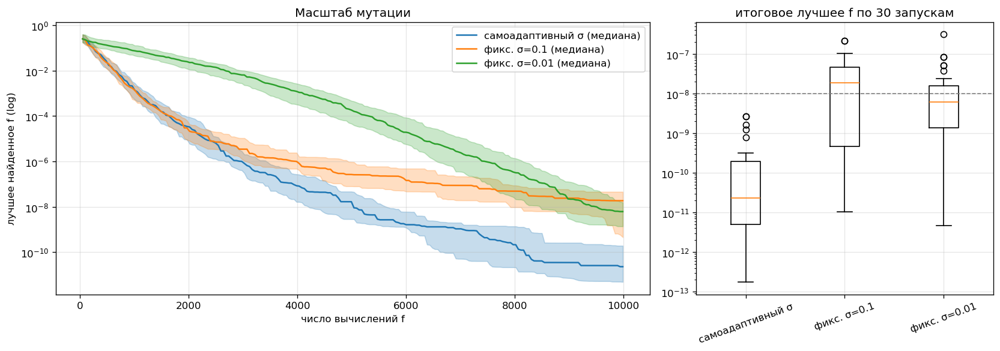
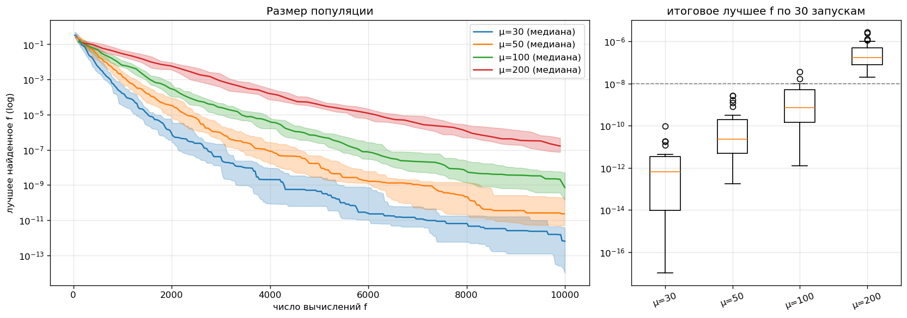
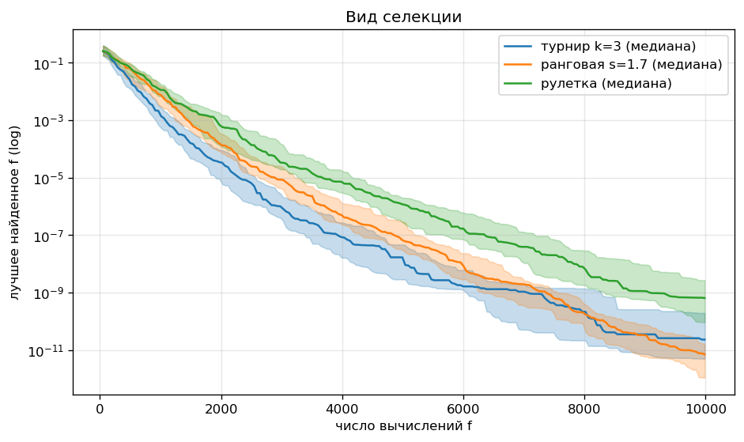
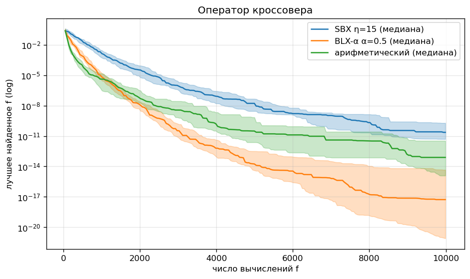
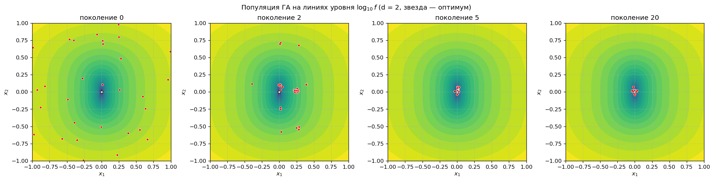

# Лабораторная работа № 1 — многомерная оптимизация генетическим алгоритмом

Код и все вычисления — [`lab1.ipynb`](lab1.ipynb), данные запусков и графики — [`results/`](results/), отчёт в PDF — [`report.pdf`](report.pdf).

## Запуск

```bash
pip install numpy pandas matplotlib scipy jupyter
cd lab1
jupyter nbconvert --to notebook --execute --inplace lab1.ipynb   # ~1 мин
```

* Запускать из папки `lab1`, результаты пишутся в `results/`
* Все параметры — в `GAConfig`; один запуск воспроизводится вызовом `run_ga(GAConfig(), seed)`

## 1. Постановка и вариант

$N = 10,\ Q = 0,\ Y = 26$

$$V = 1 + ((17N + 7Q + Y) \bmod 20) = 17, \qquad d = 5 + (V \bmod 6) = 10$$

Функция варианта 17 — Sum of Different Powers:

$$\mathbf{x}^* = \arg\min_{\mathbf{x} \in D} f(\mathbf{x}), \qquad f(\mathbf{x}) = \sum_{i=1}^{10} |x_i|^{i+1}, \qquad D = [-1, 1]^{10}$$

* Оптимум: $\mathbf{x}^* = \mathbf{0}$, $f^* = 0$
* Ограничения: только границы $-1 \le x_i \le 1$

## 2. Представление особи

* Генотип: $(\mathbf{x}, \sigma)$, где $\mathbf{x} \in \mathbb{R}^{10}$, $\sigma > 0$ — масштаб мутации
* Фенотип: $\mathbf{x}$, декодирование не нужно
* Фитнес: $f(\mathbf{x}) \to \min$

## 3. Алгоритм

Поколенческий ГА с элитизмом:

```
P(0) ~ U(D),  оценка f
   │
   ▼
┌─► evals + (μ−e) > бюджет ? ──да──► вернуть x_best
│      │ нет
│      ▼
│   селекция родителей (турнир k=3)
│      ▼
│   кроссовер пар, p_c = 0.9 (SBX)
│      ▼
│   самоадаптация sigma, гауссовская мутация, p_m = 1/d
│      ▼
│   отражение от границ, оценка f
│      ▼
│   P(t+1) = e лучших из P(t) ∪ (μ−e) потомков
└──────┘
```

### 3.1. Операторы

**Селекция — турнир** ($T$ — $k = 3$ случайных особи):

$$i^* = \arg\min_{j \in T} f_j$$

Для сравнения — ранговая ($s = 1.7$) и рулетка с масштабированием окном:

$$p_j^{\text{rank}} = \frac{2 - s}{\mu} + \frac{2 r_j (s - 1)}{\mu(\mu - 1)}, \qquad p_j^{\text{roul}} = \frac{f_{\max} - f_j + \varepsilon}{\sum_k (f_{\max} - f_k + \varepsilon)}$$

**Кроссовер — SBX** ($\eta = 15$, каждая координата с вероятностью $0.5$):

$$c^{1,2}_i = \tfrac12\big[(1 \pm \beta)\,p^1_i + (1 \mp \beta)\,p^2_i\big], \qquad \beta = \begin{cases} (2u)^{1/(\eta+1)}, & u \le 0.5 \\ (2(1-u))^{-1/(\eta+1)}, & u > 0.5 \end{cases}$$

Для сравнения — BLX-α ($\alpha = 0.5$) и арифметический:

$$c_i \sim U[m_i - \alpha I_i,\ M_i + \alpha I_i], \qquad \mathbf{c} = \lambda \mathbf{p}^1 + (1 - \lambda)\mathbf{p}^2$$

**Мутация** — каждый ген с вероятностью $p_m = 1/d$:

$$x_i' = x_i + \sigma\,\mathcal{N}(0, 1), \qquad \sigma_{\text{child}} = \sqrt{\sigma_{p_1}\sigma_{p_2}}\; e^{\tau \mathcal{N}(0,1)}, \qquad \tau = \frac{1}{\sqrt{d}}$$

**Границы** — отражение:

$$x' = 2l - x \ \ (x < l), \qquad x' = 2u - x \ \ (x > u)$$

### 3.2. Обоснование выбора

* Вещественное кодирование — пространство непрерывное, задано методичкой
* Турнир — не зависит от масштаба $f$, а значения $f$ в популяции различаются на порядки
* Самоадаптивный $\sigma$ — координаты требуют точности от $10^{-4}$ до $0.19$ (раздел 6), нужен шаг, который сам уменьшается
* Отражение вместо `clip` — не скапливает особей на границе
* Элитизм $e = 2$ — лучшее решение не теряется

### 3.3. Параметры

* $\mu = 50$, $e = 2$, бюджет $10\,000 = 1000 \cdot d$ вычислений $f$
* $p_c = 0.9$, $\eta = 15$, $p_m = 0.1$, $\sigma_0 = 0.1 \cdot (u - l)$
* Инициализация: $U(D)$; остановка — исчерпание бюджета
* Серия: $R = 30$ запусков, seed $1000 \dots 1029$; успех — $f < 10^{-8}$
* Полная таблица — [`results/base_config.csv`](results/base_config.csv)

## 4. Результаты базовой серии

| метод | best | mean | median | std | worst | успех |
|---|---|---|---|---|---|---|
| ГА | 1.8e-13 | 3.5e-10 | 2.3e-11 | 7.3e-10 | 2.7e-09 | 30/30 |
| случайный поиск | 3.9e-03 | 2.0e-02 | 1.9e-02 | 1.1e-02 | 5.0e-02 | 0/30 |
| локальный, h = 0.1 | 1.1e-05 | 1.4e-04 | 1.2e-04 | 1.1e-04 | 5.5e-04 | 0/30 |
| локальный, h = 0.01 | 1.7e-08 | 2.1e-07 | 1.8e-07 | 1.4e-07 | 6.2e-07 | 0/30 |

* U-тест Манна—Уитни, ГА против каждого метода: $p = 3 \cdot 10^{-11}$
* Время одного запуска ГА: $\approx 0.02$ с
* Лучший запуск: seed 1023, $f = 1.8 \cdot 10^{-13}$







## 5. Сравнение конфигураций (меняется один фактор)

| фактор | вариант | median | успех | p против базы |
|---|---|---|---|---|
| мутация | **самоадаптивный σ** | 2.3e-11 | 100 % | — |
| | фикс. σ = 0.1 | 1.9e-08 | 43 % | 1.4e-07 |
| | фикс. σ = 0.01 | 6.2e-09 | 73 % | 7.1e-08 |
| μ | **30** | 6.5e-13 | 100 % | 7.6e-07 |
| | 50 (база) | 2.3e-11 | 100 % | — |
| | 100 | 7.3e-10 | 90 % | 1.4e-05 |
| | 200 | 1.7e-07 | 0 % | 3.0e-11 |
| селекция | **ранговая** | 7.1e-12 | 100 % | 5.1e-03 |
| | турнир (база) | 2.3e-11 | 100 % | — |
| | рулетка | 6.5e-10 | 93 % | 8.2e-05 |
| кроссовер | **BLX-α** | 5.3e-18 | 100 % | 1.3e-10 |
| | арифметический | 7.8e-14 | 100 % | 6.5e-07 |
| | SBX (база) | 2.3e-11 | 100 % | — |









**Проверка BLX-α на сдвинутом оптимуме** $f_s(\mathbf{x}) = f(\mathbf{x} - \mathbf{s})$, $\mathbf{s} \sim U[-0.7, 0.7]^{10}$:

| кроссовер | median | успех |
|---|---|---|
| SBX | 1.5e-11 | 97 % |
| BLX-α | 6.7e-19 | 100 % |
| арифметический | 3.1e-14 | 100 % |

→ преимущество BLX-α не связано с тем, что оптимум в центре $D$.

## 6. Почему функция трудна для случайного и локального поиска

$f$ выпукла и унимодальна, трудность — **анизотропия**:

1. Порог точности по координате: $|x_i|^{i+1} < \varepsilon \iff |x_i| < \varepsilon^{1/(i+1)}$; при $\varepsilon = 10^{-8}$: $x_1$ — $10^{-4}$, $x_5$ — $0.046$, $x_{10}$ — $0.19$
2. Плато: $\partial f / \partial x_i = (i+1)|x_i|^{i} \approx 0$ при больших $i$
3. Случайный поиск: $\mathbb{P}(f < \varepsilon) \le \mathbb{P}(|x_1| < \sqrt{\varepsilon}) = 10^{-4}$ на пробу — и это только по $x_1$
4. Локальный поиск с фиксированным шагом выходит на плато: $h = 0.1 \to 10^{-4}$, $h = 0.01 \to 10^{-7}$

## 7. Выводы

1. **Самоадаптация σ — главный фактор:** фиксированный σ даёт плато ($\le 73\,\%$ успехов), самоадаптивный — $100\,\%$; σ падает $0.2 \to 0.004$
2. **Меньше μ — лучше** при этом бюджете: $G = \lfloor (10^4 - \mu)/(\mu - e) \rfloor$ = 356 поколений при μ = 30 против 49 при μ = 200
3. **Рулетка слабее:** при $f_{\max} \to 0$ веса $f_{\max} - f_j$ выравниваются → давление селекции падает
4. **BLX-α лучше SBX:** разброс по координате $\propto I_i = |p^1_i - p^2_i|$ → шаг подстраивается под каждую $x_i$ отдельно
5. Выводы 2–3 справедливы для унимодальной функции; на многоэкстремальных малое μ и сильное давление ведут к преждевременной сходимости

### Почему результат хороший

* $f^* = 0$ известен → ошибка равна $f$
* $30/30$ запусков с $f < 10^{-8}$, худший — $2.7 \cdot 10^{-9}$ → результат устойчив, а не единичный удачный запуск
* Лучше случайного поиска на $\sim 9$ порядков, локального — на $4$–$7$, различия значимы
* **Ограничение:** $f$ выпукла, поэтому градиентный метод или (1+1)-ES с правилом 1/5 тоже бы справились

### Дополнительное задание

* самоадаптивный масштаб гауссовской мутации
* ранговая селекция
* кроссоверы SBX, BLX-α, арифметический
* визуализация популяции при $d = 2$:


