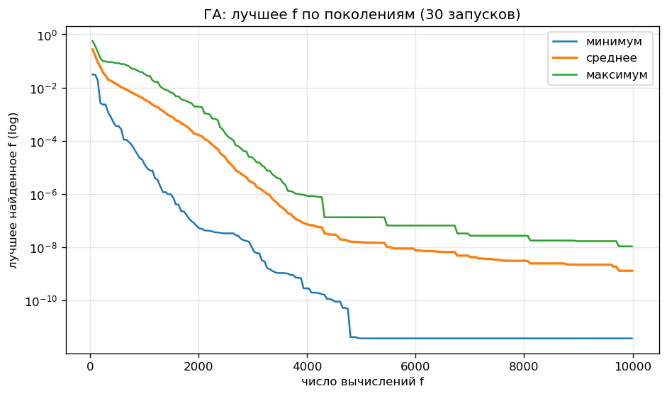
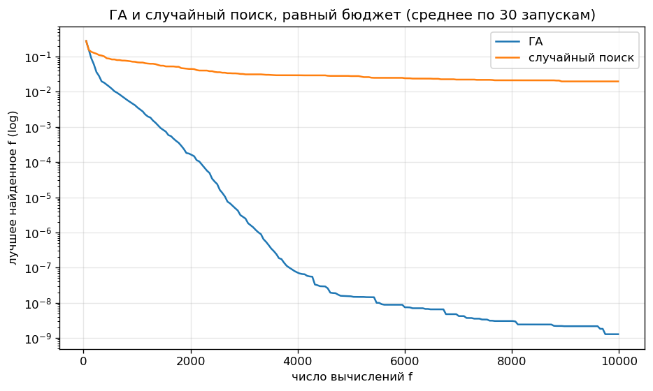
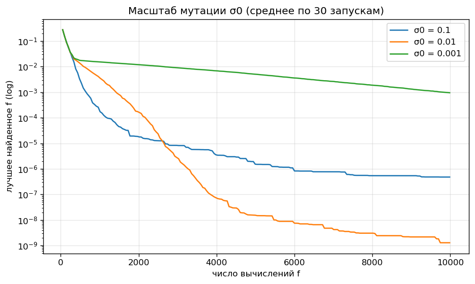

# Лабораторная работа № 1 — многомерная оптимизация генетическим алгоритмом

Код и все вычисления — [`lab1.ipynb`](lab1.ipynb), данные запусков и графики — [`results/`](results/), отчёт в PDF — [`report.pdf`](report.pdf).

## Запуск

```bash
pip install numpy pandas matplotlib jupyter
cd lab1
jupyter nbconvert --to notebook --execute --inplace lab1.ipynb   # ~10 с
```

* Запускать из папки `lab1`, результаты пишутся в `results/`
* Все параметры — в `GAConfig`; один запуск воспроизводится вызовом `run_ga(GAConfig(), seed)`

## 1. Постановка и вариант

$N = 10,\ Q = 0,\ Y = 26$

$$V = 1 + ((17N + 7Q + Y) \bmod 20) = 17, \qquad d = 5 + (V \bmod 6) = 10$$

Функция варианта 17 — Sum of Different Powers:

$$\mathbf{x}^* = \arg\min_{\mathbf{x} \in D} f(\mathbf{x}), \qquad f(\mathbf{x}) = \sum_{i=1}^{10} |x_i|^{i+1}, \qquad D = [-1, 1]^{10}$$

* Оптимум: $\mathbf{x}^* = \mathbf{0}$, $f^* = 0$
* Ограничения: только границы $-1 \le x_i \le 1$

## 2. Представление особи

* Генотип: $\mathbf{x} \in \mathbb{R}^{10}$ (вещественное кодирование)
* Фенотип: $\mathbf{x}$, декодирование не нужно
* Фитнес: $f(\mathbf{x}) \to \min$

## 3. Алгоритм

Поколенческий ГА с элитизмом:

```
P(0) ~ U(D),  оценка f
   │
   ▼
┌─► evals + (μ−e) > бюджет ? ──да──► вернуть x_best
│      │ нет
│      ▼
│   турнирная селекция родителей
│      ▼
│   равномерный кроссовер пар (p_c)
│      ▼
│   гауссовская мутация (p_m, sigma)
│      ▼
│   отражение от границ, оценка f
│      ▼
│   P(t+1) = e лучших из P(t) ∪ (μ−e) потомков
└──────┘
```

### 3.1. Операторы

**Селекция — турнир** ($T$ — $k = 3$ случайных особи):

$$i^* = \arg\min_{j \in T} f_j$$

**Кроссовер — равномерный**, к паре с вероятностью $p_c$:

$$(c^1_i,\ c^2_i) = \begin{cases} (p^1_i,\ p^2_i), & u_i < 0.5 \\ (p^2_i,\ p^1_i), & u_i \ge 0.5 \end{cases}, \qquad u_i \sim U[0, 1]$$

**Мутация — гауссовская**, каждый ген с вероятностью $p_m = 1/d$:

$$x_i' = x_i + \sigma\,\mathcal{N}(0, 1), \qquad \sigma = \sigma_0 (u - l)$$

**Границы — отражение**:

$$x' = 2l - x \ \ (x < l), \qquad x' = 2u - x \ \ (x > u)$$

### 3.2. Обоснование выбора

* Вещественное кодирование — пространство непрерывное, задано методичкой
* Турнир — не зависит от масштаба $f$, а значения $f$ в популяции различаются на порядки
* Равномерный кроссовер — перемешивает удачные координаты разных родителей
* Гауссовская мутация — единственный источник новых значений генов; $p_m = 1/d$ — в среднем один ген на особь
* Отражение — потомок остаётся в $D$ и не скапливается на границе
* Элитизм $e = 2$ — лучшее решение не теряется

### 3.3. Параметры

* $\mu = 50$, $e = 2$, $k = 3$, $p_c = 0.9$, $p_m = 0.1$, $\sigma_0 = 0.01$
* Бюджет $10\,000 = 1000 \cdot d$ вычислений $f$; остановка — исчерпание бюджета
* Инициализация: $U(D)$
* Серия: $R = 30$ запусков, seed $1000 \dots 1029$
* Таблица — [`results/base_config.csv`](results/base_config.csv)

## 4. Результаты

| метод | best | mean | median | std | worst |
|---|---|---|---|---|---|
| ГА | 3.7e-12 | 1.3e-09 | 3.1e-10 | 2.2e-09 | 1.1e-08 |
| случайный поиск | 3.9e-03 | 2.0e-02 | 1.9e-02 | 1.1e-02 | 5.0e-02 |

* Время одного запуска ГА: $\approx 0.01$ с
* Лучший запуск: seed 1006, $f = 3.7 \cdot 10^{-12}$





### 4.1. Влияние масштаба мутации $\sigma_0$

| $\sigma_0$ | best | mean | median | std | worst |
|---|---|---|---|---|---|
| 0.1 | 1.8e-09 | 4.8e-07 | 5.6e-08 | 1.2e-06 | 6.5e-06 |
| **0.01** | 3.7e-12 | 1.3e-09 | 3.1e-10 | 2.2e-09 | 1.1e-08 |
| 0.001 | 3.4e-08 | 9.5e-04 | 4.3e-05 | 2.6e-03 | 1.3e-02 |



## 5. Почему функция трудна для случайного и локального поиска

$f$ выпукла и унимодальна, трудность — **разная чувствительность координат**:

1. Порог точности по координате: $|x_i|^{i+1} < \varepsilon \iff |x_i| < \varepsilon^{1/(i+1)}$; при $\varepsilon = 10^{-8}$: $x_1$ — $10^{-4}$, $x_5$ — $0.046$, $x_{10}$ — $0.19$ → один шаг не подходит всем координатам
2. Плато: $\partial f / \partial x_i = (i+1)|x_i|^{i} \approx 0$ при больших $i$
3. Случайный поиск: $\mathbb{P}(f < \varepsilon) \le \mathbb{P}(|x_1| < \sqrt{\varepsilon}) = 10^{-4}$ на пробу — и это только по $x_1$
4. Локальный поиск с фиксированным шагом: большой шаг не уточняет $x_1$, малый — долго идёт к оптимуму (то же видно в 4.1)

## 6. Выводы

1. **ГА лучше случайного поиска на $\sim 8$ порядков** по медиане; худший запуск ГА ($1.1 \cdot 10^{-8}$) лучше лучшего запуска случайного поиска ($3.9 \cdot 10^{-3}$)
2. **Масштаб мутации — компромисс:**
   * $\sigma_0 = 0.1$ — быстрый старт, но шаг $\gg 10^{-4}$ → $x_1$ не уточняется, медиана $6 \cdot 10^{-8}$
   * $\sigma_0 = 0.001$ — шаг мал → медленно идёт к оптимуму, медиана $4 \cdot 10^{-5}$
   * $\sigma_0 = 0.01$ — лучший из трёх

### Почему результат хороший

* $f^* = 0$ известен → ошибка равна $f$
* Медиана $3 \cdot 10^{-10}$, худший из 30 запусков — $1.1 \cdot 10^{-8}$ → результат устойчив, а не единичный удачный запуск
* Лучшее решение: $|x_1| \sim 10^{-6}$, $|x_{10}| \sim 3 \cdot 10^{-3}$ — все координаты близки к нулю
* **Ограничение:** $f$ выпукла, поэтому градиентный метод тоже бы справился
