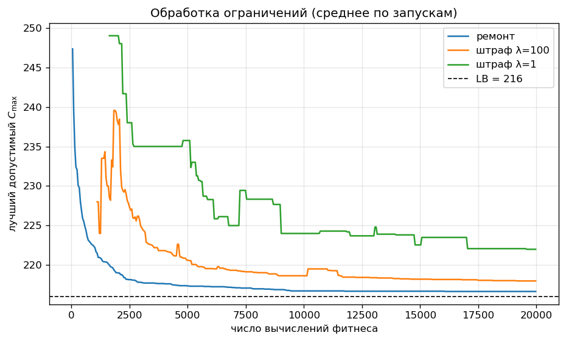
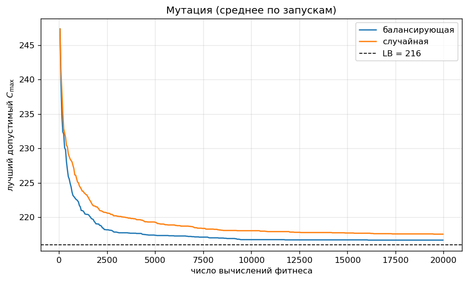
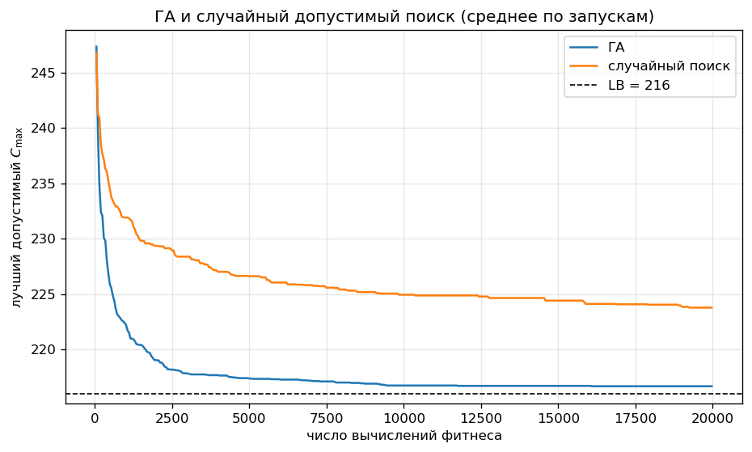
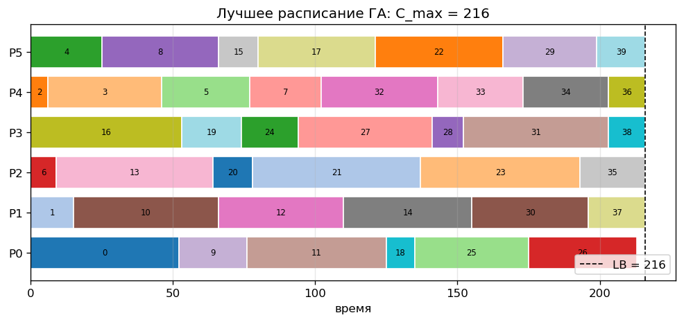

# Лабораторная работа № 2 — ГА для распределения задач по процессорам с ограничениями

Код и все вычисления — [`lab2.ipynb`](lab2.ipynb), данные, запуски и графики — [`results/`](results/), отчёт в PDF — [`report.pdf`](report.pdf).

## Запуск

```bash
pip install numpy pandas matplotlib scipy jupyter
cd lab2
jupyter nbconvert --to notebook --execute --inplace --ExecutePreprocessor.timeout=3600 lab2.ipynb   # ~10 мин
```

* Запускать из папки `lab2`, результаты пишутся в `results/`
* Все параметры — в `GAConfig`; один запуск: `run_ga(GAConfig(), generate_instance(), seed)`
* `scipy` нужен только для справочного точного оптимума

## 1. Постановка

Вариант $V = 17$ — разбиение задач на процессоры с минимизацией максимальной загрузки, представление — вектор назначений.

* $n = 40$ задач, $m = 6$ одинаковых процессоров
* Задача $i$: время $p_i$, память $w_i$; лимит памяти процессора $W$
* $E$ — пары конфликтующих задач (нельзя на один процессор)

$$L_j(\mathbf{x}) = \sum_{i:\, x_i = j} p_i, \qquad C_{\max}(\mathbf{x}) = \max_j L_j(\mathbf{x}) \to \min$$

Ограничения:

$$M_j(\mathbf{x}) = \sum_{i:\, x_i = j} w_i \le W \quad \forall j, \qquad x_a \ne x_b \quad \forall (a, b) \in E$$

Нижняя граница:

$$LB = \max\Big(\Big\lceil \tfrac{1}{m}\sum_i p_i \Big\rceil,\ \max_i p_i\Big)$$

### 1.1. Данные

* $p_i \sim U\{5, \dots, 60\}$, $w_i \sim U\{1, \dots, 20\}$, $|E| = 60$ случайных пар, seed 2026
* $W = \lceil 1.05 \cdot \tfrac1m \sum_i w_i \rceil = 77$ — запас памяти всего 5 %
* $\sum_i p_i = 1293$, $LB = 216$
* Точный оптимум (ILP, `scipy.optimize.milp`, только для справки): $C^* = 216 = LB$
* Файлы: [`results/tasks.csv`](results/tasks.csv), [`results/conflicts.csv`](results/conflicts.csv)

## 2. Представление

* Генотип: $\mathbf{x} \in \{0, \dots, m-1\}^n$, ген $x_i$ — процессор задачи $i$
* Фенотип: «процессор → список задач»; порядок задач на процессоре на $C_{\max}$ не влияет
* Любой вектор — корректное разбиение: каждая задача ровно на одном процессоре, это гарантирует кодирование
* Память и конфликты кодирование не гарантирует → штраф или ремонт

### 2.1. Примеры решений

| решение | $C_{\max}$ | перерасход памяти | конфликтов | допустимо |
|---|---|---|---|---|
| случайный вектор | 251 | 36 | 8 | нет |
| LPT | 228 | 28 | 0 | нет |
| случайный + ремонт (seed 5) | 276 | 0 | 1 | нет |
| случайный + ремонт (seed 101) | 256 | 0 | 0 | да |
| оптимум | 216 | 0 | 0 | да |

* Ремонт не всегда справляется: найти допустимое решение NP-трудно (конфликты — это раскраска графа), жадный ремонт может застрять

## 3. Алгоритм

```
P(0): случайные векторы (+ ремонт), оценка F
   │
   ▼
┌─► evals + (μ−e) > бюджет ? ──да──► вернуть лучшее допустимое
│      │ нет
│      ▼
│   турнирная селекция
│      ▼
│   равномерный кроссовер (p_c)
│      ▼
│   мутация: балансирующая / случайная
│      ▼
│   ремонт (если выбран), оценка F
│      ▼
│   P(t+1) = e лучших из P(t) ∪ (μ−e) потомков
└──────┘
```

### 3.1. Операторы

**Селекция — турнир**, $k = 3$:

$$i^* = \arg\min_{j \in T} F_j$$

**Кроссовер — равномерный:** процессор каждой задачи от одного из родителей

$$(c^1_i,\ c^2_i) = \begin{cases} (p^1_i,\ p^2_i), & u_i < 0.5 \\ (p^2_i,\ p^1_i), & u_i \ge 0.5 \end{cases}$$

* Потомок — снова вектор назначений, каждая задача ровно на одном процессоре

**Мутация — балансирующий перенос** (специализированная): задача с самого загруженного процессора переносится на наименее загруженный

$$j_{\max} = \arg\max_j L_j, \quad j_{\min} = \arg\min_j L_j, \quad i \sim U\{i : x_i = j_{\max}\}, \quad x_i \leftarrow j_{\min}$$

**Мутация — случайная** (для сравнения): каждый ген с вероятностью $p_m = 1/n$ получает другой случайный процессор

### 3.2. Ограничения

$$V(\mathbf{x}) = \sum_j \max(0,\ M_j - W) + \sum_{(a,b) \in E} [x_a = x_b]$$

**Штраф:**

$$F_\lambda(\mathbf{x}) = C_{\max}(\mathbf{x}) + \lambda V(\mathbf{x})$$

**Ремонт** (жадный): задача, которая конфликтует с соседом на своём процессоре или стоит на перегруженном, переносится на процессор без конфликтов и с местом в памяти, из таких — на наименее загруженный. Отремонтированный вектор записывается обратно в генотип; если починить не удалось — остаток штрафуется с $\lambda = 100$.

### 3.3. Обоснование

* Вектор назначений — прямое описание решения «какая задача на каком процессоре», без декодирования; ограничение «ровно один процессор» выполнено автоматически
* Равномерный кроссовер — смешивает назначения двух родителей и не ломает кодирование
* Балансирующий перенос — целевая функция зависит только от самого загруженного процессора, мутация действует именно на него
* Ремонт — ограничения тесные (запас памяти 5 %), без ремонта ГА долго бродит по недопустимым решениям
* Элитизм $e = 2$ — лучшее решение не теряется

### 3.4. Параметры

* $\mu = 50$, $e = 2$, $k = 3$, $p_c = 0.9$, $p_m = 1/n$ (для случайной мутации)
* Бюджет $20\,000$ вычислений фитнеса; инициализация — случайные векторы
* Серия: $R = 30$ запусков, seed $1000 \dots 1029$
* Таблица — [`results/base_config.csv`](results/base_config.csv)

## 4. Результаты

| метод | best | median | worst | допустимо | оптимум |
|---|---|---|---|---|---|
| **ГА: ремонт + балансирующая** | 216 | 217 | 218 | 100 % | 47 % |
| ГА: штраф λ = 100 | 216 | 217 | 227 | 90 % | 7 % |
| ГА: штраф λ = 1 | 217 | 217.5 | 249 | 40 % | 0 % |
| ГА: ремонт + случайная | 216 | 217 | 220 | 100 % | 13 % |
| случайный допустимый поиск | 221 | 224 | 227 | 100 % | 0 % |
| LPT | 228 | — | — | нет | — |
| LPT + ремонт | 249 | — | — | нет | — |

### 4.1. Ограничения



* Ремонт: допустимое решение во всех запусках, оптимум в 47 %
* **Штраф λ = 1 слишком слабый:** недопустимое решение с $V = 1$ и $C_{\max} \le 215$ имеет $F \le 216$ — не хуже допустимого оптимума → ГА выгодно нарушать
* Любое допустимое гарантированно лучше любого недопустимого при $\lambda > \sum_i p_i - LB = 1077$; λ = 100 этого не гарантирует → 10 % запусков без допустимого решения
* Цена ремонта — время: 4.2 с на запуск против 0.2 с у штрафа при том же числе вычислений фитнеса
* Скачки вверх у штрафа: среднее берётся по запускам, где допустимое уже найдено; новый запуск приходит со своим первым, плохим решением

### 4.2. Мутация



* Балансирующая: оптимум в 47 % запусков против 13 % у случайной, худший 218 против 220
* Случайная тратит мутации на процессоры, которые на $C_{\max}$ не влияют

### 4.3. Сравнение с базовыми методами



* LPT при тесной памяти не находит допустимого решения, даже после ремонта
* Случайный допустимый поиск: медиана 224 (+3.7 % к оптимуму) против 217 (+0.46 %) у ГА

### 4.4. Лучшее расписание



| процессор | задачи | время $L_j$ | память $M_j$ |
|---|---|---|---|
| 0 | 0, 9, 11, 18, 25, 26 | 213 | 76 |
| 1 | 1, 10, 12, 14, 30, 37 | 216 | 74 |
| 2 | 6, 13, 20, 21, 23, 35 | 216 | 73 |
| 3 | 16, 19, 24, 27, 28, 31, 38 | 216 | 71 |
| 4 | 2, 3, 5, 7, 32, 33, 34, 36 | 216 | 75 |
| 5 | 4, 8, 15, 17, 22, 29, 39 | 216 | 70 |

* Память везде $\le W = 77$, конфликтов нет

## 5. Выводы

1. **Ремонт лучше штрафа** при тесных ограничениях: 100 % допустимых и 47 % оптимальных запусков; слабый штраф (λ = 1) делает недопустимые решения выгодными
2. **Балансирующая мутация лучше случайной:** она действует прямо на самый загруженный процессор
3. **ГА лучше базовых методов:** LPT не находит допустимого решения, случайный поиск отстаёт на 3.7 %

### Почему результат хороший

* Оптимум известен и доказан: $C^* = LB = 216$
* Все 30 запусков ГА $\le 218$ (не хуже оптимума на 0.9 %), медиана 217, ровно оптимум — в 14 из 30
* Лучшее расписание: 5 процессоров загружены ровно на 216, шестой на 213
* **Ограничение:** при $n = 40$ точный ILP-решатель находит оптимум за $\sim 1$ с; ГА оправдан при большем $n$ и для ограничений, которые трудно записать линейно
